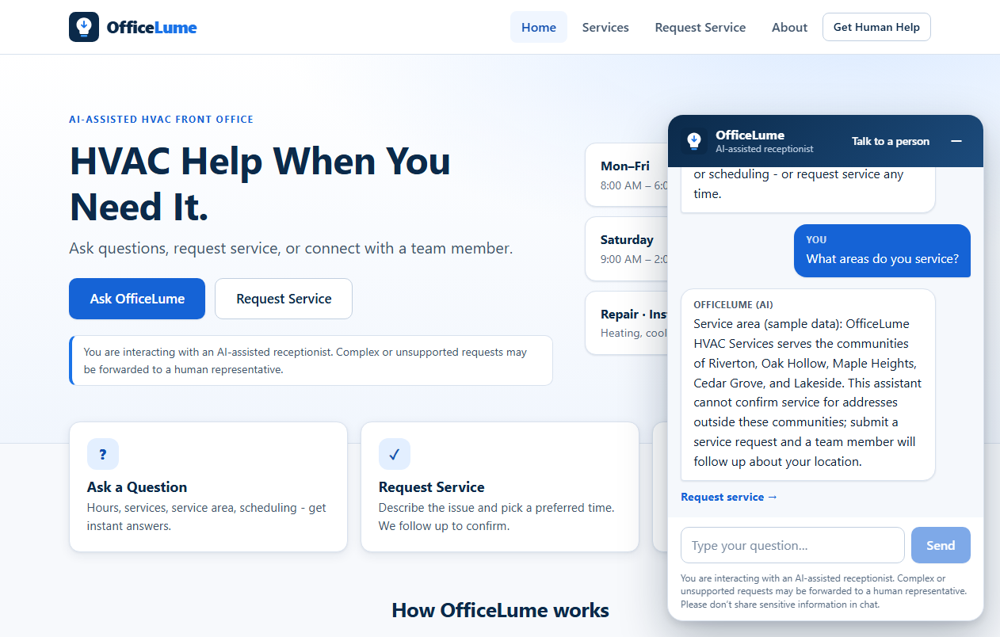
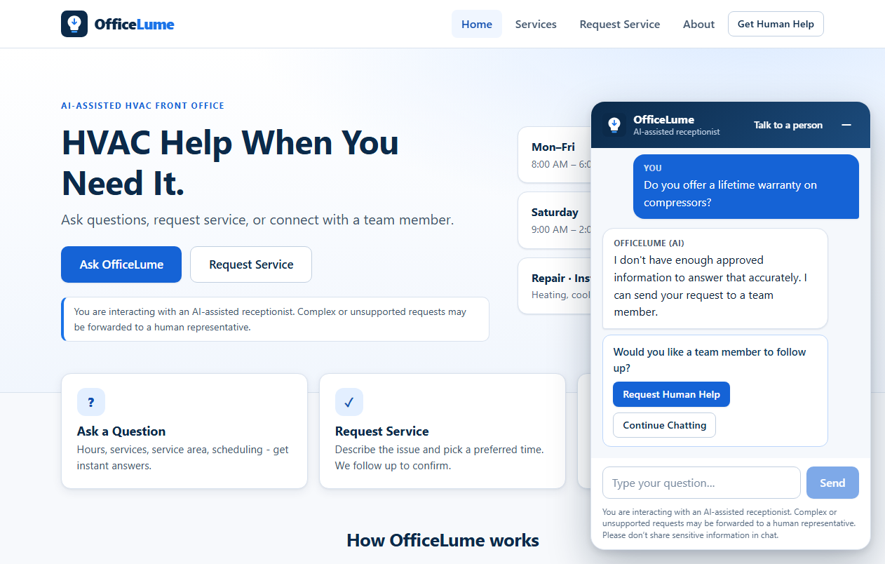
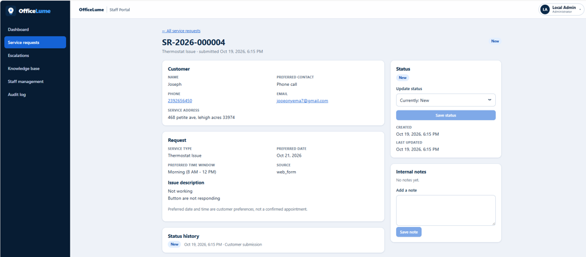
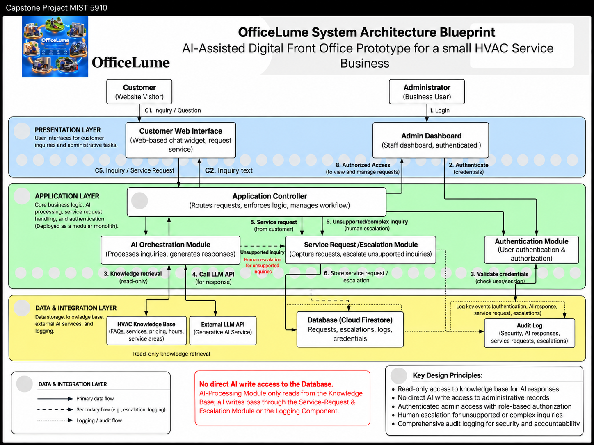
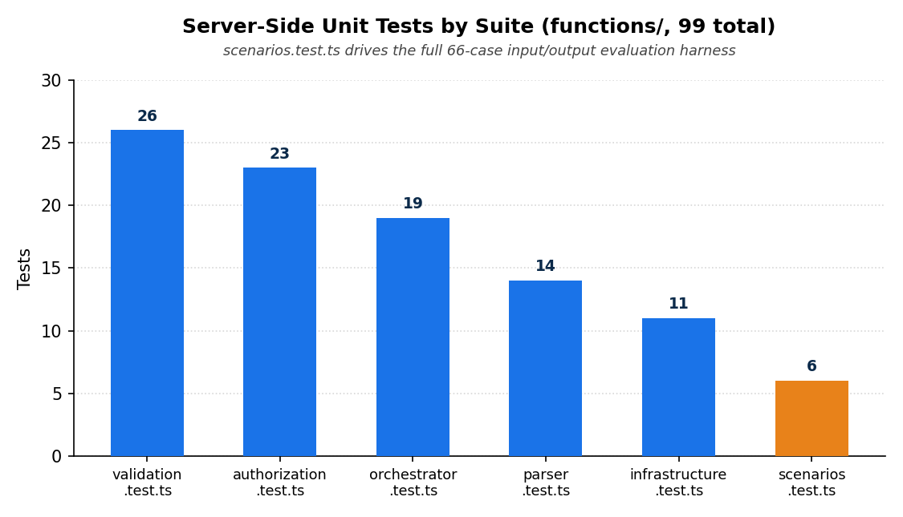
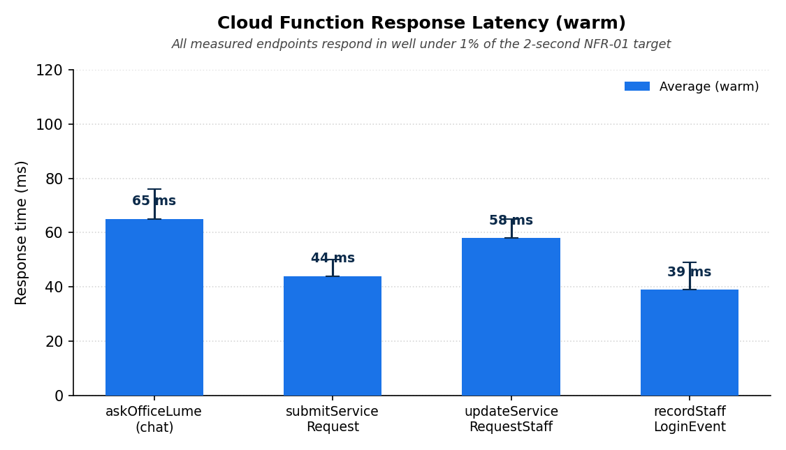

# OfficeLume

**An AI-assisted digital front office for small service businesses.**
MSIT 5910 capstone project, University of the People (2026), by Emeka Joseph Onyema.

**Portfolio page:** https://onyemaofficial.github.io/officelume-portfolio/

> The source code is kept in a private repository. Access is available on request.

---

## The problem

Small, appointment-based service businesses, such as HVAC, plumbing, and similar trades, often have no dedicated front-office staff. The owner answers calls, replies to messages, and keeps the schedule while also doing the work, so leads are missed and customers get an inconsistent experience.

## What OfficeLume does

```
Customer question → AI checks the business's approved knowledge base
  → grounded answer  OR  hand-off to a person
  → optional service request, stored securely
  → staff review requests and hand-offs in a role-based dashboard
  → every important action is written to an audit log
```

- **Answers only from approved knowledge.** If there's no approved answer, it hands the question to a person instead of guessing.
- **The AI can't act.** It can answer or escalate, but it can't create bookings, prices, or promises. An earlier design let the AI book appointments; that was removed after an OWASP review flagged "excessive agency" as a risk for LLM applications.
- **Secure by design.** The AI provider's key never reaches the browser, every change goes through validated, audited server functions, and database rules deny everything by default.

> All business details in the demo (hours, service area, services) are fictional sample data.

## Screenshots

| A supported question, answered from approved knowledge | An unsupported question, handed to a person |
|---|---|
|  |  |

**Staff dashboard:** role-based and audit-logged, showing the request a customer just submitted.



## Architecture

A three-layer design: **presentation** (customer site and staff dashboard), **application** (server functions for AI orchestration, service requests, escalations, authorization, and audit), and **data** (authentication, database, approved knowledge base, and the language model API). Every write passes through the server layer, and the database's security rules independently re-check every staff action.



The AI answer pipeline has five stages: a safety check, retrieval from the approved knowledge base, generation using only that retrieved content, validation of the model's output, and a final grounding check that blocks anything unsupported (such as an invented price or appointment) before a customer sees it.

## Results

| Measure | Result |
|---|---|
| Automated checks | 367, 0 failures, across four test levels (unit, security rules, integration, end-to-end smoke) |
| Answer-or-escalate evaluation | 100% correct across 66 scenarios |
| Server test coverage | 84–86% of statements |
| Server function speed | 39–65 ms average (warm), well under the 2-second target |





## Technology

| Area | Tools |
|---|---|
| Frontend | React 19, TypeScript, Vite, React Router |
| Backend | Firebase Authentication, Cloud Firestore and Security Rules, Cloud Functions (v2), Hosting |
| AI | Anthropic Claude API, called only from the server |
| Validation | Zod, on both client and server |
| Testing | Vitest, Testing Library, Firebase Emulator Suite |

## Engineering practices

- Formal functional and non-functional requirements (FR-01–FR-15, NFR-01–NFR-08), each traced to its implementing module and the tests that verify it.
- Two-branch Git workflow with annotated milestone releases (v0.1.0 → v1.0.0).
- Deny-by-default database rules that require both a verified role and a matching, active staff profile.
- Personal details removed from customer messages before they reach the AI.

## Contact

Joseph Onyema, MSIT candidate, University of the People.
Source code is available on request.
